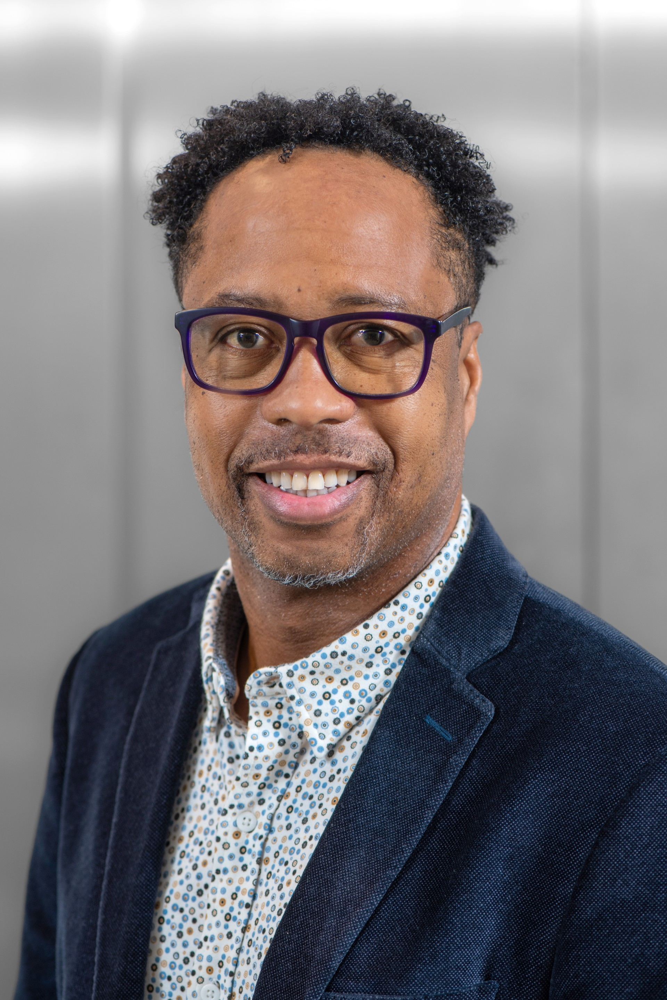
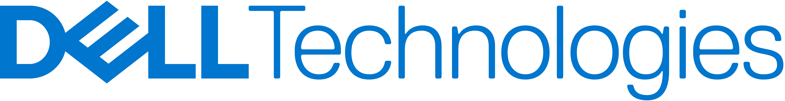
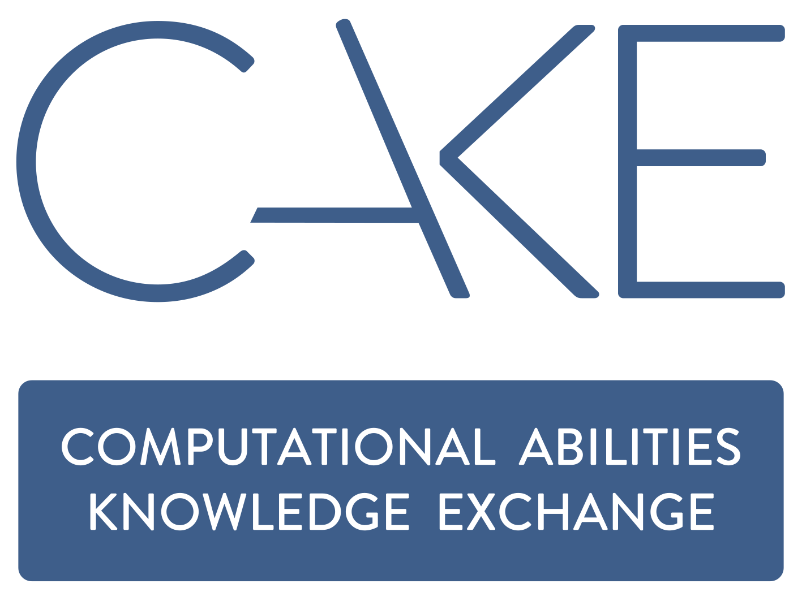
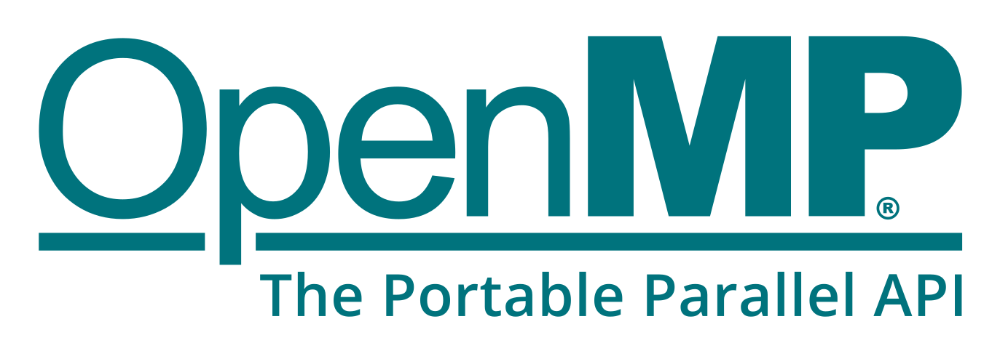
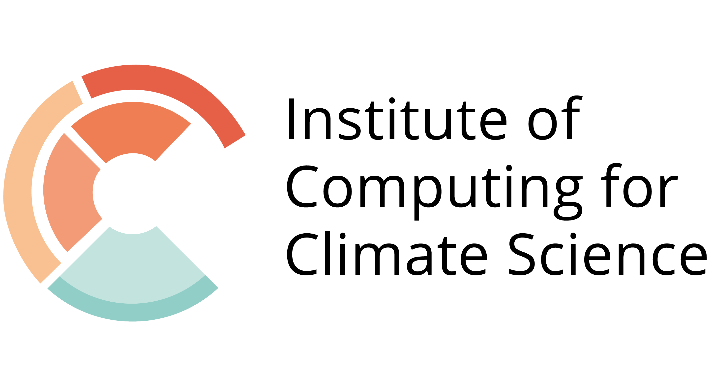

title: Celebrating 70 years of Fortran
author: Joe Wallwork
date: Last Updated: November 2026

  

## Celebrating 70 years of Fortran

Fortran has been supporting scientific software engineering and critical
infrastructure for 70 years. To celebrate this, the
[Institute of Computing for Climate Science (ICCS)][ICCS] will be holding a
'birthday party' on 1 December 2026 at the [Science and Industry Museum][MOSI],
in Manchester, UK. The timing was chosen to align with
[Computing Insights UK (CIUK)][CIUK] - 'the UK's premier conference for HPC and
associated research' - which will be held a short walk away between 2-4 December
2026.

### Outline

The birthday party event will have three parts:

- 10:00-13:00 - Parallel small community meetings: Fortran index hackathon and
                Fortran testing code clinic.
- 14:30-18:15 - Main workshop in the museum conference suite.
- 18:15-20:00 - Drinks reception in the exhibition hall, including a
                demonstration of the [Baby][baby] computer and poster
                presentations.

### Small community meetings

There will be two parallel small community meetings from 10:00-13:00, which you
can opt into when filling out the registration form.

#### Fortran index hackathon

A wealth of packages have been developed to support Fortran-based science over
the past 70 years and there are many amazing tools out there. However, they can
be difficult to find.

[Fortran index](https://fortran-index.github.io) is a hackathon series aimed at
improving the usefulness of the package index on the
[Fortran-lang](https://fortran-lang.org) community resource webpage, to make it
a 'one-stop-shop' for all Fortran-related information. Activities in the
hackathon might include improving navigability, the search function, and/or
filtering of packages. No knowledge of web development is required.

#### Fortran testing code clinic

Want to start unit testing your Fortran code but not sure where to begin? Join
our code clinic for a practical introduction to
[pFUnit](https://github.com/Goddard-Fortran-Ecosystem/pFUnit), a unit testing
framework designed for Fortran.

We'll cover the basics of writing unit tests with pFUnit and show you how to
integrate your tests into CMake and Make build systems. Then it’s your turn:
bring along your own Fortran project and spend dedicated time adding unit tests
to your code, with our in-person demonstrators on hand to help you get started
and troubleshoot along the way.

Come with your code, leave with the foundations of a working test suite!

### Workshop programme

The main workshop will be held from 14:30-18:15 in the museum conference suite.
It will take the form of a retrospective, with three sections: *past*,
*present*, and *future*. The sections are expanded upon below and are also
available [as a Fortran program][programme]!

#### Past: Keynote address

  
The main workshop will begin with a keynote address by <strong>Damian Rouson</strong> from <strong>Lawrence Berkeley National Laboratory</strong>. Damian's talk will act as a retrospective of the past 70 years, covering successes and challenges and motivating attendees to see how far we've come.

  

#### Present: Lightning talks

The 'Present' section will begin with cutting birthday cakes to be served during
a refreshment break!

There will also be a number of short talks, including sponsor talks on the
Fortran work they support, lightning talks on exciting developments underway
right now, and lightning talks on community initiatives that are making waves.

##### Exciting developments

1. *HSL: 60+ Years of Numerical Software in Fortran* - **Jennifer Scott, Rutherford Appleton Laboratory**
2. *LFortran: Compiling Production Packages and Offloading to GPUs* - **Ondřej Čertík, Microsoft**
3. *Fortitude: A Modern Fortran Linter* - **Liam Pattinson, University of York**

##### Community initiatives

1. *The UK Fortran Standards Committee* - **Christopher Brady, University of Warwick**
2. *Rebooting the UK’s Fortran Special Interest Group* - **Austen Rainer, Queen's University Belfast**
3. *The FortranFuture Network* - **Andrew Brown, Queen's University Belfast**

#### Future: Break-out discussion

The main workshop will culminate in an extended break-out discussion on the next
70 years and what direction we as a community would like the Fortran language
and its community to go in. We would like to hear from everyone, from all career
stages and from across academia, government, industry, vendors, and funders.

#### Poster presentations

Posters will be presented during the drinks reception.

1. *Fortran usage statistics from the UK national HPC service ARCHER2* - **Andy Turner, EPCC**
2. *FLight: A Mechanised Semantics for a Subset of Fortran* - **Nikolaus Huber and Dominic Orchard, University of Cambridge**
3. *PSyclone: a Fortran code-transformation framework for performance portability* - **Aidan Chalk and Andy Porter, STFC**
4. *Massively-parallel first-principles materials simulations with CASTEP* - **Phil Hasnip, University of York**

### Sponsors

This event could not have been possible without the generous support of our
sponsors. We are delighted to announce that the following organisations have
agreed to sponsor the event.

#### Platinum sponsors: [AMD][AMD] and [Dell Technologies][Dell].

  

  

#### Bronze sponsors: [CAKE][CAKE], [OpenMP][OpenMP], and [ICCS][ICCS].

  
  
  

### Registration

Attendance will be free of charge, thanks to the support of our funders and
sponsors.

To register, complete the following form:
[https://forms.gle/NjXfManJWmwLX7sc7][form].

Whilst it will be a primarily in-person event, there will also be an option to
join remotely via Zoom.

**Registration are now subject to availability. You will receive a calendar
invite as confirmation if your registration is successful upon completing the
form.**

### More information

If you have any questions about the event programme, please contact lead
organiser Joe Wallwork at `jw2423[AT]cam.ac.uk`. For administrative and
organisational queries, please contact the ICCS Operations Team at
`iccs[AT]maths.cam.ac.uk`.

#### Key links

- [Registration form][form]
- [Workshop programme][programme]
- [Event page on ICCS website][event]
- [Blog post on CAKE fellowship and marking 70 years of Fortran][blog1]
- [Blog post on 'Celebrating 70 years of Fortran' event][blog2]

[MOSI]: https://www.scienceandindustrymuseum.org.uk/
[CIUK]: https://www.sc.stfc.ac.uk/ciuk-2026/
[programme]: https://fortran-index.github.io/fortran-index/sourcefile/fortran_birthday.f90.html
[baby]: https://en.wikipedia.org/wiki/Manchester_Baby
[AMD]: https://www.amd.com/en.html
[Dell]: https://www.dell.com/en-uk
[CAKE]: https://www.cake.ac.uk/
[OpenMP]: https://www.openmp.org/
[ICCS]: https://iccs.cam.ac.uk/
[form]: https://forms.gle/NjXfManJWmwLX7sc7
[event]: https://iccs.cam.ac.uk/events/celebrating-70-years-fortran
[blog1]: https://fortran-lang.org/news/2026/01-23-Fortran-index-blogpost/
[blog2]: https://fortran-lang.org/news/2026/09-15-Fortran-birthday/
